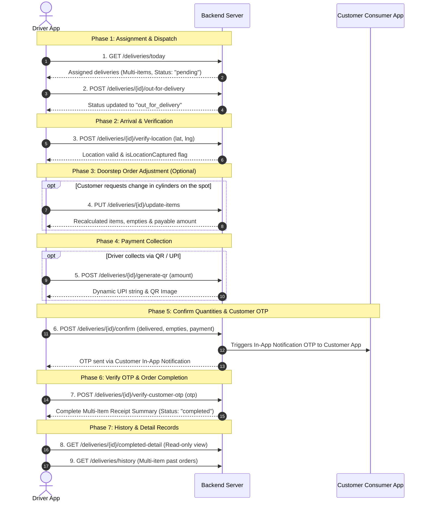

# MBGA Delivery Partner App — Flow-Based API Specification (v3.0)

> **Scope:** Field Delivery Operations, Dynamic Orders, Empty Cylinder Ledger, Dynamic QR & Notifications  
> *(Note: Authentication & FCM Device Registration are already live and excluded here)*  
> **API Base URL:** `https://mbga.clocktales.com`  
> **Base Path:** `/api/v1/delivery`  
> **Target Audience:** Backend Team (Gaurav ji & Team)  
> **Date:** September 30, 2026  

---

## 1. Complete End-to-End Delivery Flow Overview

The endpoints below are named and sequenced strictly according to the driver's real-world delivery lifecycle:



---

## 2. Order Status Lifecycle

Only the following 4 official statuses are used across the entire mobile application:
- `pending`: Order assigned to driver, waiting to start.
- `out_for_delivery`: Driver has started route towards customer.
- `completed`: Customer OTP verified; delivered items, empties, and payments recorded.
- `failed`: Delivery could not be fulfilled (e.g. customer unavailable/cancelled).

*(Note: `timeSlot` has been completely removed from the UI and is not required in any API).*

---

## 3. Step-by-Step API Specification

---

### Step 1: `GET /api/v1/delivery/deliveries/today`
**Purpose:** Fetches all assigned deliveries for today.  
**Key Features:** Multi-item cylinder list, expected empty cylinder dues formula, customer location lock status.

#### Headers
```http
Authorization: Bearer <accessToken>
```

#### Response (200 OK)
```json
{
  "success": true,
  "data": [
    {
      "id": "del_982341",
      "orderNumber": "ORD1257",
      "status": "pending", // "pending" | "out_for_delivery" | "completed" | "failed"
      "deliveryDate": "2026-09-30",
      "customer": {
        "id": "cust_4512",
        "name": "Hotel Green Palace",
        "phone": "9876543210",
        "address": "Shop 4, Market Complex, Station Road, Jaipur",
        "latitude": 26.9124,
        "longitude": 75.7873,
        "isLocationCaptured": true // If true, location is already locked; driver does not need to re-capture
      },
      "distanceKm": 3.4,

      // --- Multi-Item Cylinders to Deliver ---
      "items": [
        {
          "cylinderType": "19_KG_COMMERCIAL",
          "label": "19 KG Commercial",
          "quantity": 4,
          "unitPrice": 1800.00,
          "totalPrice": 7200.00
        },
        {
          "cylinderType": "47.5_KG_INDUSTRIAL",
          "label": "47.5 KG Industrial",
          "quantity": 2,
          "unitPrice": 4450.00,
          "totalPrice": 8900.00
        }
      ],

      // --- Empty Cylinders Return Requirement ---
      // Expected = currentOrderQuantity + customerPreviousDue
      "emptyReturns": [
        {
          "cylinderType": "19_KG_COMMERCIAL",
          "label": "19 KG Empty",
          "currentOrderQuantity": 4,
          "customerPreviousDue": 1, // Past unreturned empties from previous deliveries
          "expectedQuantity": 5     // 4 + 1 = 5 to collect
        },
        {
          "cylinderType": "47.5_KG_INDUSTRIAL",
          "label": "47.5 KG Empty",
          "currentOrderQuantity": 2,
          "customerPreviousDue": 0,
          "expectedQuantity": 2
        }
      ],

      // --- Billing & Balance Summary ---
      "billing": {
        "orderSubtotal": 16100.00,
        "taxAmount": 0.00,
        "customerPreviousBalance": 0.00, // Previous unpaid cash balance
        "totalPayableAmount": 16100.00
      }
    }
  ]
}
```

---

### Step 2: `POST /api/v1/delivery/deliveries/{id}/out-for-delivery`
**Purpose:** Triggered when driver taps **"Out for Delivery"** on the Order Details screen. Updates order status from `pending` to `out_for_delivery`.

#### Request Body
```json
{}
```

#### Response (200 OK)
```json
{
  "success": true,
  "data": {
    "deliveryId": "del_982341",
    "orderNumber": "ORD1257",
    "status": "out_for_delivery",
    "updatedAt": "2026-09-30T10:15:00Z"
  }
}
```

---

### Step 3: `POST /api/v1/delivery/deliveries/{id}/verify-location`
**Purpose:** Validates driver's live GPS coordinates upon reaching customer location. If `isLocationCaptured` is false, it saves and locks the customer's coordinates in the system so future deliveries don't require repeat GPS verification.

#### Request Body
```json
{
  "latitude": 26.9125,
  "longitude": 75.7874
}
```

#### Response (200 OK)
```json
{
  "success": true,
  "data": {
    "deliveryId": "del_982341",
    "isAtLocation": true,
    "distanceMetersFromDestination": 15.2,
    "isLocationCaptured": true, // Customer's location is permanently saved/locked
    "message": "Location verified successfully"
  }
}
```

---

### Step 4: `PUT /api/v1/delivery/deliveries/{id}/update-items`
**Purpose:** Triggered when driver opens **"+ Update Order"** at customer doorstep to adjust cylinder quantities or add new cylinder sizes.

#### Request Body
```json
{
  "updatedItems": [
    {
      "cylinderType": "19_KG_COMMERCIAL",
      "quantity": 5 // Changed from 4 to 5
    },
    {
      "cylinderType": "47.5_KG_INDUSTRIAL",
      "quantity": 2
    },
    {
      "cylinderType": "5_KG_DOMESTIC",
      "quantity": 1 // Newly added cylinder type
    }
  ],
  "reason": "Customer requested 1 extra 19kg and 1 5kg cylinder at delivery point"
}
```

#### Response (200 OK)
Returns the complete recalculated delivery object with:
- Updated `items` and line-item prices.
- Recalculated `emptyReturns` (adding expected empties for newly added types).
- Recalculated `billing.totalPayableAmount`.

---

### Step 5: `POST /api/v1/delivery/deliveries/{id}/generate-qr` *(CRITICAL MISSING ENDPOINT)*
**Purpose:** Triggered when driver selects **"QR / UPI"** payment mode and taps **"Generate QR"** on Confirm Delivery screen. Generates a dynamic UPI QR Code encoded with the exact bill amount (Full or entered Partial amount) and Order Number.

#### Request Body
```json
{
  "amount": 16100.00, // Or entered partial amount (e.g. 10000.00)
  "paymentSplit": "full" // "full" | "partial"
}
```

#### Response (200 OK)
```json
{
  "success": true,
  "data": {
    "deliveryId": "del_982341",
    "orderNumber": "ORD1257",
    "amount": 16100.00,
    "upiString": "upi://pay?pa=mbga.clocktales@hdfcbank&pn=Madhav%20Bharat%20Gas&am=16100.00&tr=ORD1257&cu=INR",
    "qrImageUrl": "https://mbga.clocktales.com/media/qr/ORD1257_16100.png",
    "expiresInSeconds": 600
  }
}
```

---

### Step 6: `POST /api/v1/delivery/deliveries/{id}/confirm`
**Purpose:** Driver submits final handed-over cylinders, collected empties, and collected payment.  
> **IMPORTANT NOTE FOR BACKEND:** This triggers a 4-digit Delivery OTP sent to the **Customer's Consumer App as an In-App Notification / Push Notification** (NOT SMS).

#### Request Body
```json
{
  // Final cylinders handed over
  "deliveredItems": [
    { "cylinderType": "19_KG_COMMERCIAL", "quantity": 4 },
    { "cylinderType": "47.5_KG_INDUSTRIAL", "quantity": 2 }
  ],

  // Empties actually collected back
  "collectedEmpties": [
    { "cylinderType": "19_KG_COMMERCIAL", "quantity": 3 }, // e.g. 3 collected out of 5 expected
    { "cylinderType": "47.5_KG_INDUSTRIAL", "quantity": 2 }
  ],

  // Structured Payment Collection
  "payment": {
    "method": "cash", // "cash" | "upi_qr"
    "split": "partial", // "full" | "partial"
    "amountCollected": 10000.00,
    "payableAmount": 16100.00,
    "pendingBalance": 6100.00 // Balance recorded on customer ledger
  },

  "driverNotes": "Customer returned 3 empties; 2 empties pending for next delivery."
}
```

#### Response (200 OK)
```json
{
  "success": true,
  "data": {
    "deliveryId": "del_982341",
    "customerOtpRequired": true,
    "otpChannel": "IN_APP_NOTIFICATION", // OTP sent to Customer Consumer App
    "message": "OTP has been sent to customer's app notification"
  }
}
```

---

### Step 7: `POST /api/v1/delivery/deliveries/{id}/verify-customer-otp`
**Purpose:** Verifies the 4-digit OTP provided by customer. Marks order `completed` and returns the **Multi-Item Receipt Summary** for the Delivery Completed screen.

#### Request Body
```json
{
  "otp": "4829"
}
```

#### Response (200 OK) — Complete Multi-Item Receipt
```json
{
  "success": true,
  "data": {
    "deliveryId": "del_982341",
    "orderNumber": "ORD1257",
    "status": "completed",
    "completedAt": "04:28 PM",

    // --- Multi-Item Delivered Breakdown ---
    "totalDeliveredQuantity": 6,
    "deliveredItems": [
      { "cylinderType": "19_KG_COMMERCIAL", "label": "19 KG Commercial", "quantity": 4 },
      { "cylinderType": "47.5_KG_INDUSTRIAL", "label": "47.5 KG Industrial", "quantity": 2 }
    ],

    // --- Multi-Item Empty Collected Breakdown ---
    "totalEmptyCollectedQuantity": 5,
    "emptyCollectedItems": [
      { "cylinderType": "19_KG_COMMERCIAL", "label": "19 KG Empty", "quantity": 3 },
      { "cylinderType": "47.5_KG_INDUSTRIAL", "label": "47.5 KG Empty", "quantity": 2 }
    ],

    // --- Empty Ledger Update ---
    "emptyDueSummary": {
      "expectedTotal": 7,
      "collectedTotal": 5,
      "addedToCustomerPendingDue": 2
    },

    // --- Payment Settlement ---
    "payment": {
      "method": "cash", // "cash" | "upi_qr"
      "split": "partial", // "full" | "partial"
      "totalBillAmount": 16100.00,
      "amountCollected": 10000.00,
      "pendingBalance": 6100.00
    }
  }
}
```

---

### Step 8: `GET /api/v1/delivery/deliveries/{id}/completed-detail` *(CRITICAL MISSING ENDPOINT)*
**Purpose:** Fetches the full read-only details of an already completed order when driver taps it from the Orders list or History tab.

#### Response (200 OK)
```json
{
  "success": true,
  "data": {
    "id": "del_982341",
    "orderNumber": "ORD1257",
    "status": "completed",
    "deliveryDate": "2026-09-30",
    "completedAt": "04:28 PM",
    "customer": {
      "name": "Hotel Green Palace",
      "phone": "9876543210",
      "address": "Shop 4, Market Complex, Station Road, Jaipur"
    },
    "deliveredItems": [
      { "cylinderType": "19_KG_COMMERCIAL", "label": "19 KG Commercial", "quantity": 4 },
      { "cylinderType": "47.5_KG_INDUSTRIAL", "label": "47.5 KG Industrial", "quantity": 2 }
    ],
    "emptyItems": [
      { "cylinderType": "19_KG_COMMERCIAL", "label": "19 KG Empty", "quantity": 3 },
      { "cylinderType": "47.5_KG_INDUSTRIAL", "label": "47.5 KG Empty", "quantity": 2 }
    ],
    "payment": {
      "method": "cash",
      "split": "partial",
      "totalAmount": 16100.00,
      "amountPaid": 10000.00,
      "pendingBalance": 6100.00
    },
    "driverNotes": "Customer returned 3 empties; 2 empties pending for next delivery."
  }
}
```

---

### Step 9: `GET /api/v1/delivery/deliveries/history`
**Purpose:** Fetches past completed or failed orders with multi-item summaries.

#### Query Parameters:
- `period`: `"today"` | `"week"` | `"all"`
- `page`: `1`
- `limit`: `20`

#### Response (200 OK)
```json
{
  "success": true,
  "data": {
    "items": [
      {
        "id": "del_982341",
        "orderNumber": "ORD1257",
        "customerName": "Hotel Green Palace",
        "status": "completed",
        "deliveryDate": "2026-09-30",
        "completedAt": "04:28 PM",
        "totalDeliveredCount": 6,
        "totalEmptiesCount": 5,
        "itemsSummary": "4 × 19 KG, 2 × 47.5 KG",
        "payment": {
          "method": "cash",
          "amount": 10000.00,
          "status": "PARTIAL"
        }
      }
    ],
    "total": 45,
    "page": 1,
    "limit": 20
  }
}
```

---

### Step 10: `GET /api/v1/delivery/driver/inventory`
**Purpose:** Displays truck's live stock by cylinder type on the Home screen.

#### Response (200 OK)
```json
{
  "success": true,
  "data": {
    "totalFullCylinders": 22,
    "totalEmptyCylinders": 14,
    "activeDeliveriesCount": 4,
    "stockByType": [
      { "cylinderType": "19_KG_COMMERCIAL", "label": "19 KG Commercial", "fullCount": 16, "emptyCount": 10 },
      { "cylinderType": "47.5_KG_INDUSTRIAL", "label": "47.5 KG Industrial", "fullCount": 6, "emptyCount": 4 }
    ]
  }
}
```

---

### Step 11: `PATCH /api/v1/delivery/driver/status`
**Purpose:** Home screen On-Duty / Off-Duty toggle.  
**Request Body:** `{ "onDuty": true }`  
**Response (200 OK):** `{ "success": true, "data": { "onDuty": true } }`

---

### Step 12: `GET /api/v1/delivery/driver/profile`
**Purpose:** Driver profile tab and today's shift totals.  
**Response (200 OK):**
```json
{
  "success": true,
  "data": {
    "id": "drv_102",
    "name": "Ramesh Kumar",
    "phone": "9876543210",
    "vehicleNumber": "RJ-14-GA-5621",
    "role": "DELIVERY_PARTNER",
    "onDuty": true,
    "avatarInitials": "RK",
    "shiftStats": {
      "completedDeliveriesToday": 5,
      "cashCollectedToday": 42500.00,
      "totalEmptiesCollectedToday": 28
    }
  }
}
```

---

### Step 13: `GET /api/v1/delivery/notifications` & `/unread-count`
- `GET /notifications`: Driver alerts list.
- `GET /notifications/unread-count`: Returns `{ "unreadCount": 3 }`.
- `PATCH /notifications/{id}/read`: Marks notification read.

---

## 4. Master Enums Reference

### Cylinder Types Enum:
| `cylinderType` Enum | UI Display Label | Standard Rate |
|---|---|---|
| `5_KG_DOMESTIC` | 5 KG Domestic | ₹550.00 |
| `14.2_KG_DOMESTIC` | 14.2 KG Domestic | ₹900.00 |
| `19_KG_COMMERCIAL` | 19 KG Commercial | ₹1,800.00 |
| `35_KG_INDUSTRIAL` | 35 KG Industrial | ₹3,300.00 |
| `47.5_KG_INDUSTRIAL` | 47.5 KG Industrial | ₹4,450.00 |

### Order Statuses:
`pending` ➔ `out_for_delivery` ➔ `completed` (or `failed`)
